<h1 align="center">👋 Hola, soy Ulises Pignatelli</h1>

  <b>Cybersecurity Engineer · Pentester · SysAdmin Engineer</b> 
  <i>Seguridad ofensiva, análisis de vulnerabilidades y automatización defensiva</i>

  
  
  
  

---

## 🛡️ Sobre mí

Ingeniero en Sistemas Informáticos especializado en **ciberseguridad**, con foco en **pentesting** y análisis de vulnerabilidades. Actualmente me desempeño como **Cybersecurity Engineer** en la Empresa Provincial de la Energía de Santa Fe (EPE), donde evolucioné desde un rol de SysAdmin hacia la seguridad ofensiva y defensiva.

- 🎯 Hago **Penetration Testing** sobre aplicaciones web bajo metodologías de hacking ético (OWASP).
- 🔬 Investigo **CVEs** a fondo: explotabilidad, impacto en el negocio y recomendaciones de mitigación.
- 🤖 Automatizo procesos de seguridad e inteligencia de amenazas con **Python** y **Bash**.
- 📚 Candidato a **MSc in Computer Security** (Maestría en Seguridad Informática) — TECH México.

---

## 🎯 Áreas de especialización

  
  
  
  
  
  
  
  

---

## 🚀 Proyectos destacados

> Herramientas de seguridad propias, enfocadas en pentesting y defensa. Todas open source y documentadas.

| Proyecto | Descripción | Stack |
|---|---|---|
| **[🛰️ VulnWatch](https://github.com/ulisespignatelli/vulnwatch)** · [demo](https://ulisespignatelli.github.io/vulnwatch) | Plataforma de inteligencia de vulnerabilidades: recolecta **todas las CVEs** nuevas (NVD, CVE.org, CISA KEV, EPSS) y noticias de seguridad, las prioriza por riesgo real y las publica de forma automática. 100% serverless y gratuito. | `Python` `GitHub Actions` `Pillow` |
| **[📝 Pentest Findings Builder](https://github.com/ulisespignatelli/pentest-findings-builder)** | Generador de reportes de pentesting con scoring **CVSS**: convierte hallazgos en informes técnicos claros y accionables para el cliente. | `Python` `CVSS` |
| **[🔐 JWT Security Analyzer](https://github.com/ulisespignatelli/jwt-security-analyzer)** | Analizador de seguridad de tokens **JWT**: detecta algoritmos débiles, malas configuraciones y vectores de ataque comunes. | `JavaScript` `Security` |
| **[📊 WebLog Sentinel](https://github.com/ulisespignatelli/weblog-sentinel)** | Detector de ataques en logs web: identifica patrones de SQLi, XSS, path traversal y fuerza bruta sobre registros de servidores. | `Python` `Log Analysis` |

---

## 🧰 Stack & herramientas

**Seguridad ofensiva**

  
  
  
  
  
  

**Defensa & Blue Team**

  
  
  
  

**Automatización**

  
  
  

**Infraestructura & Cloud**

  
  
  
  
  

---

## 💼 Experiencia profesional

### 🔴 Cybersecurity Engineer — *Empresa Provincial de la Energía de Santa Fe*
`Sept. 2025 – Presente · Rosario, Argentina`

- Penetration Testing sobre aplicaciones web para identificar y explotar vulnerabilidades bajo hacking ético.
- Investigación profunda de CVEs: análisis de explotabilidad, impacto en el negocio y mitigaciones efectivas.
- Triage y resolución de incidentes críticos desde la consola EDR **Trend Vision One**.
- Reportes técnicos de **Threat Intelligence** para la toma de decisiones estratégicas.
- Implementación de parches y robustecimiento defensivo a partir de los hallazgos ofensivos.

### 🔵 SysAdmin Engineer — *Empresa Provincial de la Energía de Santa Fe*
`Abr. 2022 – Ago. 2025 · Rosario, Argentina`

- **SOC**: monitoreo continuo y análisis de eventos con Trend Micro Vision One, orquestando la respuesta ante intrusiones.
- **Seguridad perimetral**: administración de firewalls **Fortinet** (FortiGate, FortiManager, FortiAnalyzer) — políticas IPS, VPN y bloqueo de IoC.
- **Hardening & automatización**: blindaje de servidores Linux con scripts propios en Bash y Python.
- **Virtualización & resiliencia**: entornos VMware, monitoreo con Zabbix y backups con Veeam Backup & Replication.

---

## 🎓 Formación

- 🎓 **Ingeniero en Sistemas Informáticos** — Universidad Abierta Interamericana (UAI)
- 📚 **MSc in Computer Security** *(en curso)* — TECH México
- 🔎 **Diplomatura en Perito Informático Forense** *(en curso)*

---

## 📊 Estadísticas de GitHub

<!--

  

 -->
<!-- 

  

  

 -->

  
  

  

---

## 📫 Contacto

¿Te interesó alguno de mis proyectos o querés hablar de seguridad? Escribime:

  
  

<i>"La mejor defensa nace de entender el ataque."</i> 🛡️

